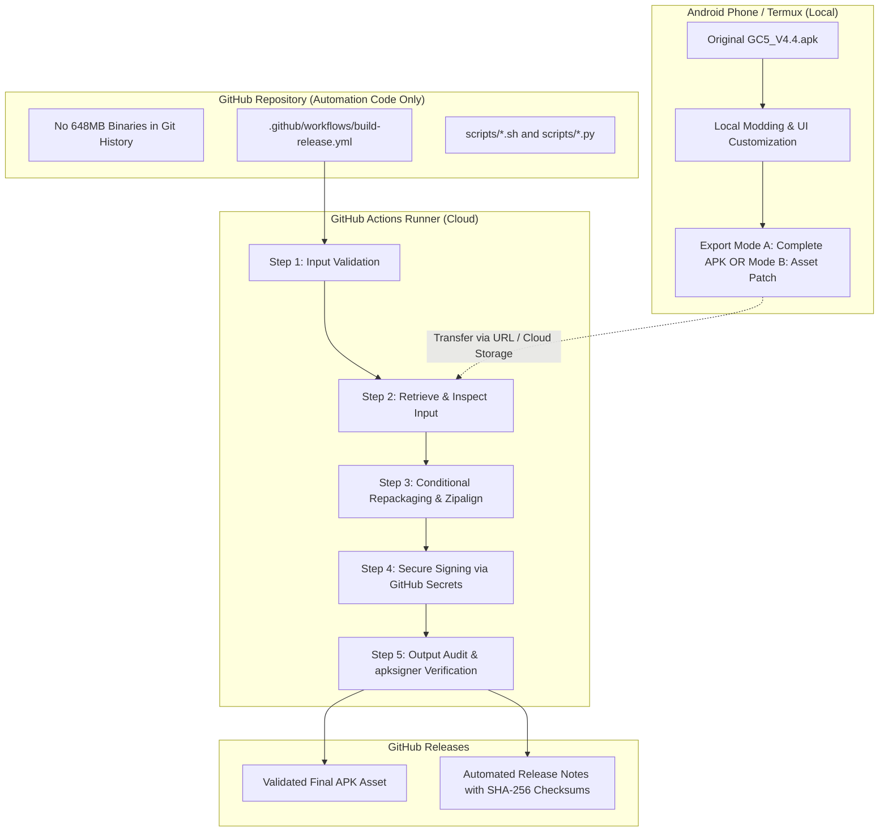

# GC5 Mobile Mod: Automated APK Build & GitHub Release Pipeline

An automated, cloud-based packaging, alignment, cryptographic signing, and release pipeline for **Grand Criminal Online (GC5)** mobile game modifications (Unity 2021.3.45f1, IL2CPP Android).

---

## 📌 Architecture Overview



---

## ⚙️ 1. What This System Does and Does Not Do

### ✅ What It Does:
* **Decouples Code from 648MB Binaries:** Keeps the Git repository lightweight (<1 MB) while handling multi-hundred-megabyte game packages entirely in the CI cloud runner.
* **Dual-Mode Input Processing:** Supports both pre-packaged complete APKs (Mode A) and modular asset/texture patches (Mode B).
* **Strict Archive Inspection:** Audits the internal integrity of `classes.dex`, `AndroidManifest.xml`, `assets/bin/Data/data.unity3d`, and native `libil2cpp.so`.
* **Zero-Compression Alignment:** Automatically aligns native libraries and 4-byte boundaries using Android SDK `zipalign`.
* **Cryptographic Multi-Scheme Signing:** Signs with APK Signature Schemes **v1 (JAR), v2 (APK Signature Scheme), and v3** using keys securely injected via GitHub Secrets.
* **Zero-Trust Verification:** Validates that the output APK is genuinely parseable by Android build tools and verified by `apksigner verify` before any release is created.
* **Automated GitHub Releases:** Publishes the signed APK directly as a downloadable release asset with cryptographic checksums and build notes.

### ❌ What It Does Not Do:
* **Does not compile C# scripts from source:** The target is a compiled IL2CPP game. C# source files (`.cs`) cannot be converted into `libil2cpp.so` without the original Unity 2021.3.45f1 Editor and NDK toolchain.
* **Does not bypass Android signature certificate requirements:** If signed with your own custom keystore, Android will block updates over the original developer's version. You must uninstall the original game first.
* **Does not bypass runtime Anti-Cheat Toolkit (ACTk) protections:** While asset and texture modifications generally bypass memory/assembly checks, modified native code (`libil2cpp.so`) may require explicit anti-cheat patches.

---

## 📦 2. Supported Input Modes

| Input Mode | Parameter (`input_mode`) | Description | Best For |
| :--- | :--- | :--- | :--- |
| **Mode A** | `complete_apk` | Complete modified `.apk` file supplied via URL or local path. | When APK repackaging and editing is completed inside Termux. |
| **Mode B** | `asset_patch` | Base APK + separate patch archive (`.zip` containing modified `data.unity3d`, sprites, or `libil2cpp.so`). | When maintaining small patch files without transferring the full 648 MB APK each time. |

---

## 💾 3. Large File Handling Strategy (648 MB APK)

Because the original game package is ~648 MB, standard Git commits are unsuitable:

1. **Direct Git Commit (Avoided):** GitHub blocks files larger than 100 MB. Committing 600+ MB files bloats repository clones and quickly causes repository lockups.
2. **Git LFS (Optional):** Supports large files, but consumes bandwidth quotas rapidly on free/pro tiers.
3. **External URL Transfer (Recommended):** The workflow accepts a direct HTTP/HTTPS URL (`apk_source`). You can host the base APK on temporary cloud storage (Google Drive direct link, Cloudflare R2, private S3, or self-hosted HTTP server) and download it directly into the GitHub Actions runner.
4. **GitHub Release Asset Transfer:** You can upload the original base APK once to a private release or tag, and feed its direct asset URL to the build workflow.

---

## 🔐 4. Configuring Signing Secrets

To sign APKs with your custom private key, configure four repository secrets in **GitHub Repository $\rightarrow$ Settings $\rightarrow$ Secrets and variables $\rightarrow$ Actions**:

1. **`KEYSTORE_BASE64`**: The entire keystore file (`.jks` or `.keystore`) encoded in Base64.
   ```bash
   # Generate on Termux or Linux:
   base64 -w 0 my-release-key.jks > keystore_base64.txt
   # Copy contents of keystore_base64.txt into KEYSTORE_BASE64 secret
   ```
2. **`KEYSTORE_PASSWORD`**: Password used to lock/unlock the keystore.
3. **`KEY_ALIAS`**: The alias name assigned to the key when created.
4. **`KEY_PASSWORD`**: Password for the private key alias.

> [!WARNING]
> **Safe Failure:** If these secrets are not configured and `allow_fallback_debug_signing` is `false`, the workflow terminates immediately. It will **never** claim an APK is signed if it was not.

---

## 🚀 5. How to Run the Workflow Manually

1. Navigate to the **Actions** tab in your GitHub repository.
2. Select **"Build & Release GC5 Mobile Mod"** from the left sidebar.
3. Click **"Run workflow"** on the right side.
4. Fill in the dispatch parameters:
   * **Input Mode:** `complete_apk` or `asset_patch`
   * **APK Source:** Direct download URL to your modified APK (e.g. `https://example.com/GC5_modified.apk`)
   * **Expected SHA-256 (Optional):** Checksum to guarantee file was not corrupted during transit.
   * **Release Tag (Optional):** e.g. `v4.4-mod-v1.0` (auto-generates timestamp tag if left blank).
   * **Release Title (Optional):** e.g. `GC5 v4.4 Minimalist UI Overhaul`.
   * **Allow Fallback Debug Signing:** Check only for quick testing if you haven't added production keystore secrets yet.
5. Click **"Run workflow"**.

---

## 📱 6. Future Termux Integration Workflow (Phone $\rightarrow$ Cloud)

When you are ready to connect Termux directly to this automation without committing binaries to Git:

### Step 1: Install GitHub CLI in Termux
```bash
pkg install gh
gh auth login
```

### Step 2: Trigger the Workflow Remotely from Termux
```bash
# Calculate local APK checksum:
SHA=$(sha256sum /sdcard/Download/GC5_V4.4.apk | awk '{print $1}')

# Trigger remote GitHub Actions workflow:
gh workflow run build-release.yml \
  -f input_mode="complete_apk" \
  -f apk_source="https://your-host.com/GC5_V4.4.apk" \
  -f expected_sha256="${SHA}" \
  -f release_tag="v4.4-ui-clean" \
  -f release_title="GC5 v4.4 Clean UI Release"
```

### Step 3: Download the Final Signed APK
Once the workflow completes, download the published release asset directly back to your device:
```bash
gh release download v4.4-ui-clean --pattern "*.apk" --dir /sdcard/Download/
```

---

## 🛠️ 7. Unity & IL2CPP Modification Matrix

| Modification Type | Tools Required | Can CI Handle Without Unity Editor? | Note |
| :--- | :--- | :---: | :--- |
| **UI Reskinning (Textures, Icons, Sprites)** | `UnityPy`, Pillow, Python | ✅ **Yes** | Replaces raw textures inside `data.unity3d` without modifying IL2CPP binaries. |
| **Complete APK Repackaging** | `zipalign`, `apksigner` | ✅ **Yes** | Aligns and signs APK produced on Termux. |
| **HUD / Logic Toggling** | Hex Editor, Il2CppDumper, Ghidra | ✅ **Yes** (if patched `.so` provided) | Pre-patched `libil2cpp.so` can be injected via Mode B. |
| **C# Script Compilation** | Unity 2021.3.45f1 + Android Build Support | ❌ **No** | Requires the full Unity Editor and IL2CPP compiler suite. |

---

## 🔒 8. Security & Failure Handling

* **Untrusted Input Sanitization:** All files and archives are tested with integrity checks before unpacking. No executable code from APKs is evaluated on the runner.
* **Minimal Permissions:** Workflow uses `permissions: contents: write` strictly for Release asset publishing.
* **Safe Halts:** If `apksigner verify` fails or critical Unity components (`libil2cpp.so`, `data.unity3d`) are missing, the workflow exits with code 1 and **does not create a release**.
